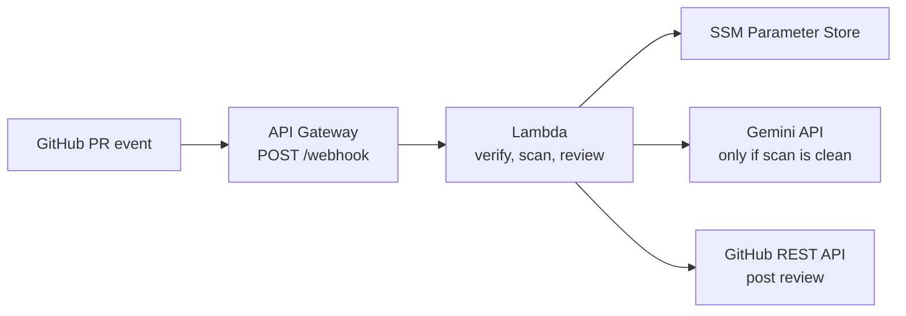

# MergeGuard AI — Serverless DevSecOps PR Reviewer

> **Status: in development (M6).** The webhook pipeline, the Gemini AI review, the Terraform stack, the Phase 2 reliability work (a queue-based receiver and worker, a commit status, stale-review dismissal, scanner suppressions, alarms, and a CI deploy workflow) and the Phase 3 distribution work (GitHub App authentication, inline comments, per-repository configuration) are implemented and tested, but **never deployed**. Gemini has only been tested against mocked responses, AWS and GitHub only with fakes and a mocked Terraform provider, and the deploy workflow has never run. See the [roadmap](docs/PRD.md#18-roadmap) and [backlog](docs/TASKS.md).

MergeGuard AI reviews GitHub pull requests automatically, without any server to run:

1. GitHub sends a signed `pull_request` webhook to an **Amazon API Gateway HTTP API**.
2. An **AWS Lambda** receiver (Python 3.12, no third-party runtime packages) verifies the HMAC-SHA256 signature, answers GitHub at once and queues a metadata-only request in **Amazon SQS**. A worker Lambda picks it up and fetches the PR's changed files.
3. A deterministic **secret scanner** checks the added lines. If it finds credentials, the PR gets a *changes requested* review, and the code is **not** sent to any AI service.
4. Otherwise **Google Gemini** produces a structured review (risk level, bug count, feedback), which MergeGuard posts on the PR together with a `mergeguard/review` commit status. Findings can also appear as inline comments on the offending lines. When a later push fixes the problem, the old blocking review is dismissed. MergeGuard can act as a GitHub App (`<app>[bot]`) instead of a personal token, and a repository can tune it with `.github/mergeguard.json` on its base branch. MergeGuard never approves or merges; a human always decides.
5. Secrets live in **AWS SSM Parameter Store**. All infrastructure is defined in **Terraform**.

## Documentation

| Start here | |
| --- | --- |
| [Documentation index](docs/README.md) | All documents and the status legend |
| [Product requirements](docs/PRD.md) | What MergeGuard does and why |
| [Architecture](docs/ARCHITECTURE.md) | How it is built, including the review of the reference code |
| [Security](docs/SECURITY.md) | Threat model and controls |
| [Deployment](docs/DEPLOYMENT.md) | How to deploy and operate it |
| [AGENTS.md](AGENTS.md) / [CONTRIBUTING.md](CONTRIBUTING.md) | How to work in this repository |

## Maintainer

[@ChamathDilshanC](https://github.com/ChamathDilshanC). See [CONTRIBUTORS.md](CONTRIBUTORS.md).

## License

No licence has been chosen yet ([OQ-11](docs/PRD.md#17-open-questions)). Until one is added, all rights are reserved by the maintainer.
