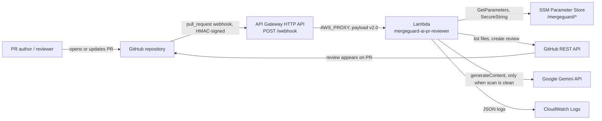
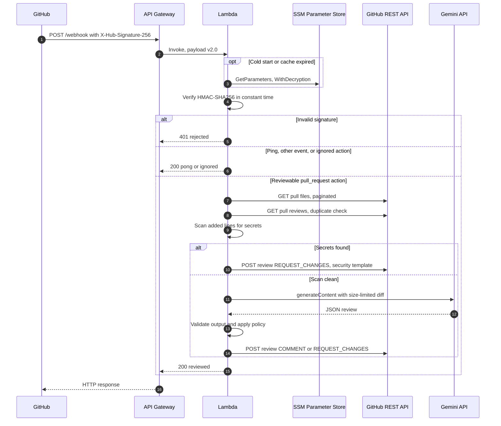
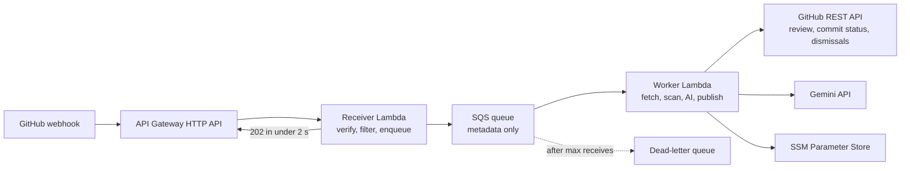

# MergeGuard AI — System Architecture

| Field | Value |
| --- | --- |
| Status | Draft v0.1 — M1 foundation and M2 webhook pipeline (no AI) implemented; **not deployed** |
| Last updated | 2026-10-21 |
| Owner | [@ChamathDilshanC](https://github.com/ChamathDilshanC) |
| Related | [PRD](PRD.md) · [API spec](API_SPEC.md) · [Security](SECURITY.md) · [Deployment](DEPLOYMENT.md) · [ADRs](ADR/README.md) |

## 1. Purpose and status

This document describes how MergeGuard AI is built. It covers the **Phase 1 (MVP)** architecture, which follows the owner's brief with its defects fixed, and the **Phase 2–3 target architecture**.

**Current state (verified 2026-10-21):**

- **M1** added the project skeleton, dev tooling, a Terraform skeleton without resources, and a CI workflow (§4.1).
- **M2** added the webhook pipeline without AI: signature check, event triage, secret scan, decision policy, review posting with the own-PR fallback, duplicate prevention, dry run and structured logging. It is covered by unit, contract and integration tests.
- **Not yet built:** the AI review (M3) and Terraform resources (T-401). Nothing is deployed. Component names below come from the brief (Planned) or are recommendations (Proposed).

## 2. System context



**System boundary:** MergeGuard owns the API Gateway endpoint, the Lambda function and its code, the IAM role, the log group, and the SSM parameters. GitHub and Google Gemini are external systems with their own availability and data terms.

## 3. Technology inventory

| Concern | Technology | Status |
| --- | --- | --- |
| Language and runtime | Python 3.12 on AWS Lambda (`python3.12`) | Planned (brief) |
| Runtime dependencies | Standard library (`json`, `hmac`, `hashlib`, `re`, `urllib.request`) + bundled `boto3` | Planned (brief), [ADR-0002](ADR/0002-zero-runtime-dependencies.md) |
| HTTP entry point | Amazon API Gateway HTTP API, `$default` stage, route `POST /webhook` | Planned (brief) |
| Compute | AWS Lambda, 256 MB, 30 s timeout | Planned (brief) |
| Secrets | AWS SSM Parameter Store `SecureString`, AWS-managed key `aws/ssm` | Planned (brief), [ADR-0003](ADR/0003-secrets-in-ssm-parameter-store.md) |
| Logs | Amazon CloudWatch Logs, `/aws/lambda/mergeguard-ai-pr-reviewer` | Planned (brief), retention Proposed |
| AI | Google Gemini `generateContent`, model `gemini-2.5-flash` (configurable) | Planned (brief) |
| Source control integration | GitHub webhooks + REST API, fine-grained PAT | Planned (brief) |
| Infrastructure as code | Terraform `>= 1.5, < 2.0`; providers `hashicorp/aws` (`~> 5.0` in brief, locked at 5.100.0) and `hashicorp/archive` (`~> 2.4`, locked at 2.8.1) | Skeleton Verified (M1); resources Planned (T-401); AWS major version [OQ-07](PRD.md#17-open-questions) |
| Async processing | Amazon SQS standard queue + dead-letter queue | Proposed (Phase 2), [ADR-0005](ADR/0005-async-webhook-processing.md) |
| Dev tooling | `pytest` 9.1.1, `pytest-cov` 7.1.0, `ruff` 0.16.10 (`requirements-dev.txt`); Terraform 1.16.5 and `checkov` 3.3.26 pinned in CI (dev-only) | Verified (M1), except checkov (CI only) |
| CI/CD | GitHub Actions `ci.yml` (lint, tests, Terraform checks); deploy with AWS access via OIDC role (no static keys) | CI added in M1, pending first run; deploy Proposed (Phase 2) |

## 4. Repository and module map

### 4.1 Current

```text
.
├── .github/workflows/ci.yml   # Lint, tests, Terraform fmt/validate, checkov
├── .gitignore
├── .python-version            # 3.12 (Lambda runtime)
├── AGENTS.md                  # Coding-agent and contributor operating guide
├── CONTRIBUTING.md
├── CONTRIBUTORS.md
├── README.md
├── pyproject.toml             # ruff, pytest, coverage configuration
├── requirements-dev.txt       # Pinned dev-only tools
├── docs/                      # This documentation suite
├── src/
│   ├── lambda_function.py     # Lambda entry point (M2)
│   └── mergeguard/            # M2 modules; AI modules arrive in M3
├── terraform/
│   ├── .terraform.lock.hcl
│   ├── providers.tf
│   ├── variables.tf           # Variables from DEPLOYMENT.md section 4; no resources yet
│   └── versions.tf
└── tests/
    ├── fixtures/webhooks/     # Sanitised webhook payloads
    ├── integration/           # Handler end to end with fake GitHub and SSM
    ├── support.py             # Shared fakes and fake-secret helpers
    └── unit/                  # Module tests; scanner corpus and self-scan in unit/scanner/
```

### 4.2 Proposed (Phase 1)

The brief's layout (`src/lambda_function.py`, `terraform/main.tf`) is the baseline. It is split into small modules so each concern can be tested in isolation, still with zero runtime dependencies. The Lambda handler stays `lambda_function.lambda_handler`.

```text
src/
├── lambda_function.py         # Thin entry point: parse API Gateway event, call pipeline, map result to HTTP
└── mergeguard/
    ├── __init__.py
    ├── config.py              # Environment variables + cached SSM loading
    ├── webhook.py             # Body decoding, signature verification, event/action filtering
    ├── http.py                # Small urllib transport with timeouts (injectable for tests)
    ├── github_client.py       # PR files (paginated), reviews, later statuses and dismissals
    ├── scanner.py             # Deterministic secret rules over added lines
    ├── ai_reviewer.py         # Gemini request, prompt, response-schema validation
    ├── prompts.py             # Versioned prompt text
    ├── policy.py              # Pure decision function (FR-010)
    ├── render.py              # Markdown templates and sanitisation (DESIGN_SYSTEM.md)
    ├── models.py              # Dataclasses (section 7)
    ├── logging_util.py        # JSON log helper with redaction
    └── pipeline.py            # One review: files, duplicate check, scan, decision, post
tests/
├── unit/
├── integration/               # Handler-level tests with fake transport
└── fixtures/                  # Sanitised webhook payloads, PR file lists, Gemini responses
terraform/
├── versions.tf                # Terraform and provider constraints
├── providers.tf
├── variables.tf
├── main.tf                    # IAM, Lambda, log group, HTTP API
└── outputs.tf                 # github_webhook_url
```

Terraform packages the code with `archive_file` using `source_dir = "../src"` instead of the brief's single `source_file`.

## 5. Components and responsibilities (Phase 1)

| Component | Responsibility | Key rules |
| --- | --- | --- |
| API Gateway HTTP API | Public TLS endpoint; only route is `POST /webhook` | Unmatched routes get `404` without invoking Lambda; stage throttling (Proposed) |
| `lambda_function` (handler) | Translates the payload v2.0 event into a pipeline call and the result into an HTTP response | No business logic; catches unexpected errors and returns `500` with the delivery ID only |
| `webhook` | Decodes the body (base64 when flagged), verifies `X-Hub-Signature-256`, filters `X-GitHub-Event` and `action` | Verify before parsing; fail closed |
| `config` | Reads `MERGEGUARD_*` environment variables; loads the three SSM parameters with one `GetParameters` call; caches with a TTL | Never logs values |
| `github_client` | `GET .../pulls/{n}/files` with pagination; `GET`/`POST .../pulls/{n}/reviews` | `X-GitHub-Api-Version` header; timeouts; maps `401`/`403`/`404`/`422`/`429` to typed errors |
| `scanner` | Applies secret rules to added lines and returns findings (rule, file, line, masked hint) | Pure function; versioned rule set |
| `ai_reviewer` | Builds the prompt, calls Gemini with the key in a header, validates the JSON | Untrusted-input prompting; bounded timeout; no tools or function calling |
| `policy` | Maps scan findings and the AI result to a review event | Pure function; never `APPROVE` |
| `render` | Produces the review Markdown from templates; sanitises model text; enforces length caps | Hidden marker `<!-- mergeguard:v1 ... -->` |
| `logging_util` | Emits one JSON object per line | Allow-listed fields only |
| `pipeline` | Orders one review: files, duplicate check, scan, (AI from M3), decision, render, post with own-PR fallback | No HTTP or signature concerns; returns an `Outcome` for the handler |

## 6. Request lifecycle



**Time budget (Phase 1, synchronous):** API Gateway HTTP APIs allow at most 30 s per integration, matching the brief's Lambda timeout. Each GitHub call gets a 10 s timeout. The Gemini timeout is derived from `context.get_remaining_time_in_millis()`, reserving at least 5 s to post the review. GitHub itself waits only **10 s** for a response, so slow AI calls show up as failed deliveries even when the review is posted. Phase 2 fixes this ([§15](#15-target-architecture-phase-2-and-3)).

## 7. Domain model

MergeGuard is **stateless and has no database by design**. GitHub stores PRs and reviews; SSM stores secrets. These in-memory types (`models.py`, Proposed) structure the pipeline:

| Type | Key fields | Notes |
| --- | --- | --- |
| `Triage` (`webhook.py`) | `status`, `reason`, `action`, `pull_request` | Result of triaging an authenticated delivery |
| `PullRequestRef` | `repo` (`owner/name`), `number`, `head_sha`, `author_login`, `draft` | From `pull_request` payload; validated (repository name, 40/64-hex SHA) |
| `ChangedFile` | `filename`, `status`, `patch` (optional) | From the PR files API |
| `DiffBundle` | `files`, `text`, `truncated`, `omitted_files` | M3; built under `MERGEGUARD_MAX_DIFF_CHARS` |
| `SecretFinding` | `rule_id`, `filename`, `line` | Holds no part of the matched value (no masked hint either) |
| `AIReview` | `risk_level`, `bugs_found`, `summary`, `feedback_markdown`, `model` | Validated output |
| `Decision` (`policy.py`) | `event`, `template`, `reason` | Output of `policy`; `render` turns it into the review body |
| `Outcome` (`pipeline.py`) | `http_status`, `status`, `reason` | Mapped to the HTTP response envelope |

## 8. Integration contracts

Full request and response shapes are in [API_SPEC.md](API_SPEC.md). Summary:

| Direction | Interface | Auth | Failure handling |
| --- | --- | --- | --- |
| Inbound | `POST /webhook` (GitHub webhook) | HMAC-SHA256 shared secret | `401` on bad signature; `2xx` for ignored events |
| Outbound | GitHub REST API `pulls/{n}/files`, `pulls/{n}/reviews` | Fine-grained PAT, `Bearer` header | Typed errors; `422` own-PR fallback; `500` for retryable failures |
| Outbound | Gemini `models/{model}:generateContent` | API key in `x-goog-api-key` header | Fail-open to AI-unavailable comment |
| Outbound | SSM `GetParameters` | Lambda execution role | Fail closed (`500`) |

## 9. Security architecture

Details and the threat model are in [SECURITY.md](SECURITY.md).

- **Authentication of GitHub → MergeGuard:** HMAC-SHA256 over the raw body, verified with `hmac.compare_digest`.
- **Authentication of MergeGuard → GitHub:** fine-grained PAT scoped to the selected repositories. Permissions: *Pull requests: read and write*, *Contents: read* (brief), and *Commit statuses: read and write* from Phase 2.
- **Authorisation inside AWS:** one execution role. Its inline policy allows `logs:CreateLogStream` and `logs:PutLogEvents` on the function's own log group, plus `ssm:GetParameter` / `ssm:GetParameters` on `arn:aws:ssm:<region>:<account>:parameter/mergeguard/*`. The brief used `*` for region and account; Terraform should build these ARNs from `aws_region` and `aws_caller_identity` data sources. Explicit `kms:Decrypt` is only needed if a customer-managed KMS key replaces `aws/ssm`.
- **Secrets boundary:** secret values exist only in SSM and Lambda memory. They are created outside Terraform, so they never reach Terraform state.
- **Data egress:** code leaves AWS only towards Gemini, and only after a clean secret scan ([ADR-0004](ADR/0004-secret-scan-gate-before-ai.md)).

## 10. Configuration strategy

| Kind | Name | Default | Source | Status |
| --- | --- | --- | --- | --- |
| Secret | `<prefix>/github_token` | — | SSM `SecureString` | Planned (brief) |
| Secret | `<prefix>/webhook_secret` | — | SSM `SecureString` | Planned (brief) |
| Secret | `<prefix>/gemini_api_key` | — | SSM `SecureString` | Planned (brief) |
| Env var | `MERGEGUARD_PARAM_PREFIX` | `/mergeguard` | Terraform | Proposed |
| Env var | `MERGEGUARD_GEMINI_MODEL` | `gemini-2.5-flash` | Terraform | Proposed |
| Env var | `MERGEGUARD_MAX_DIFF_CHARS` | `12000` | Terraform | Proposed (value from brief) |
| Env var | `MERGEGUARD_MAX_FILES` | `300` | Terraform | Proposed |
| Env var | `MERGEGUARD_LOG_LEVEL` | `INFO` | Terraform | Proposed |
| Env var | `MERGEGUARD_DRY_RUN` | `false` | Terraform | Proposed |
| Terraform var | `aws_region` | `us-east-1` | `terraform.tfvars` | Proposed (value from brief) |

Environment variables hold **non-secret** settings only. Terraform variables are listed in [DEPLOYMENT.md](DEPLOYMENT.md) §4.

## 11. Errors, retries and idempotency

| Failure | Behaviour | HTTP status to GitHub |
| --- | --- | --- |
| Invalid or missing signature | Reject, no calls | `401` |
| Malformed JSON after a valid signature | Reject | `400` |
| SSM unavailable or parameter missing | Fail closed | `500` |
| GitHub `401`/`403` (auth or permissions) | Log `github.auth_failed`, no retry | `500` |
| GitHub `422` on `REQUEST_CHANGES` for own PR | Retry once as `COMMENT` (FR-010) | `200` |
| GitHub `429`, `5xx` or no response | One retry after 1 s if time allows, then fail. POSTs are retried only on rate limits: a POST that got a `5xx` may already have created the review | `500` |
| Gemini timeout, `429`, `5xx`, safety block, invalid JSON | AI-unavailable `COMMENT` (FR-008) | `200` |
| Unexpected exception | Log type and delivery ID (no payload) | `500` |

**Retries:** GitHub does **not** redeliver failed webhooks automatically. Operators redeliver from *Settings → Webhooks → Recent Deliveries*. Returning `500` for retryable failures makes them visible there.

**Idempotency (FR-014):** stateless. Reviews are created with `commit_id = head_sha` and a hidden marker, and MergeGuard checks existing reviews before posting. Redeliveries, `reopened` events, and Phase 2 queue retries are therefore safe without a database.

## 12. Observability

- **Logs:** structured JSON events defined in [DESIGN_SYSTEM.md](DESIGN_SYSTEM.md) §7, such as `webhook.received`, `scan.completed`, `ai.completed`, `review.posted`. Every line carries `delivery_id`, which links a GitHub delivery to its logs.
- **Metrics (built-in):** Lambda `Invocations`, `Errors`, `Duration`, `Throttles`; API Gateway `4xx`, `5xx`, `Latency`.
- **Metrics (Proposed, Phase 2):** CloudWatch Embedded Metric Format counters for `SecretFindings`, `ReviewsPosted` by event, `AIFailures` by reason. These are emitted through log lines, so they need no extra dependency.
- **Alarms (Proposed, Phase 2):** Lambda errors > 0 over 15 minutes; DLQ depth > 0; AWS Budgets threshold.
- **Tracing:** not planned for Phase 1. AWS X-Ray active tracing can be enabled on the Lambda later without code changes.

## 13. Test architecture

Summary only; see [TESTING_STRATEGY.md](TESTING_STRATEGY.md).

- Pure modules (`scanner`, `policy`, `render`, `webhook`) get exhaustive unit tests.
- Network modules take an injectable `http` transport. Integration tests run the real handler against recorded, sanitised GitHub and Gemini fixtures, with no network.
- Infrastructure checks: `terraform fmt -check`, `terraform validate`, `checkov`.
- One manual end-to-end run against a sandbox repository before each release.

## 14. Deployment topology

Phase 1: one AWS account and region (default `us-east-1`), one Lambda, one HTTP API. Each target repository has a webhook pointing at the same URL with the same secret. Terraform runs from the maintainer's machine, with local state unless OQ-08 decides otherwise. Step-by-step instructions are in [DEPLOYMENT.md](DEPLOYMENT.md).

## 15. Target architecture (Phase 2 and 3)



| Change | Phase | Requirement / ADR |
| --- | --- | --- |
| Split receiver and worker; SQS with DLQ; receiver answers `202` | 2 | FR-016, [ADR-0005](ADR/0005-async-webhook-processing.md) |
| Commit status `mergeguard/review` on head SHA | 2 | FR-017 |
| Dismiss stale MergeGuard `REQUEST_CHANGES` reviews | 2 | FR-018 |
| Worker re-checks the current head SHA before posting | 2 | PRD EC-07 |
| Remote Terraform state (S3, encrypted, locked) and CI deploy via OIDC | 2 | [DEPLOYMENT.md](DEPLOYMENT.md) §8 |
| GitHub App installation tokens; Checks API | 3 | FR-020, [ADR-0006](ADR/0006-github-identity-pat-then-app.md) |
| Inline comments; per-repository JSON config | 3 | FR-021, FR-022 |

Both Lambdas share one code package with different handlers, which keeps [ADR-0002](ADR/0002-zero-runtime-dependencies.md) intact.

## 16. Review of the reference implementation

The brief's reference Python and Terraform code was reviewed before any implementation. These defects must **not** be carried over. Every task in [TASKS.md](TASKS.md) that touches these areas references the relevant `RB-` ID.

| ID | Area | Defect in brief | Consequence | Fix | Task |
| --- | --- | --- | --- | --- | --- |
| RB-01 | Python | The `findings_str = ...` line inside the secret-leak branch is indented one space deeper than its block | `IndentationError` at import: every invocation fails and API Gateway returns `500` | Consistent indentation; `ruff` in CI | T-102, T-207 |
| RB-02 | Scanner | Private-key pattern `-----BEGIN (RSA\|OPENSSH\|PRIVATE) KEY-----` matches only `BEGIN PRIVATE KEY`, not `BEGIN RSA PRIVATE KEY`, `BEGIN OPENSSH PRIVATE KEY` or `BEGIN EC PRIVATE KEY` | False negatives for the most common key formats | Pattern covering optional key-type words before `PRIVATE KEY` | T-205 |
| RB-03 | Scanner | Scans the whole patch, including removed and context lines | A PR that **removes** a leaked secret is blocked | Scan added lines only | T-205 |
| RB-04 | Webhook | `X-GitHub-Event` is not checked; only `action` is | Other subscribed events with `action: opened` (for example issues) raise `KeyError` and return `500` | Filter on event first (FR-003) | T-201 |
| RB-05 | Flow | Gemini is called synchronously inside the webhook request | Exceeds GitHub's 10 s delivery timeout; deliveries show as failed | Phase 2 async (FR-016) | T-501 |
| RB-06 | GitHub | PR files fetched without pagination | Only the first 30 files are scanned and reviewed, silently | `per_page=100` + pagination + cap (FR-004) | T-204 |
| RB-07 | Gemini | API key passed in the URL query string | Key can leak through exception messages, logs, or proxies | `x-goog-api-key` header | T-301 |
| RB-08 | HTTP | `urlopen` called without timeouts | A hung connection consumes the full Lambda timeout | Explicit timeouts and deadline budget | T-204, T-301 |
| RB-09 | Errors | No handling of HTTP errors or non-JSON model output | Unhandled exceptions: no review, no feedback to the author | Typed errors, fail-open AI (FR-008) | T-303 |
| RB-10 | GitHub | `REQUEST_CHANGES` posted with a PAT whose owner may be the PR author | GitHub rejects it with `422`, so the demo scenario posts nothing | `COMMENT` fallback (FR-010); bot identity (ADR-0006) | T-207 |
| RB-11 | GitHub | New reviews on `synchronize` never dismiss earlier `REQUEST_CHANGES` | PR stays blocked after the author fixes the issue (under branch protection) | FR-018 | T-503 |
| RB-12 | GitHub | No duplicate protection | Redeliveries and reopen events post duplicate reviews | FR-014 | T-209 |
| RB-13 | Config | SSM read at import time, three calls, no TTL, no error handling | Init failures are opaque; rotation needs a cold start | Lazy `GetParameters` with TTL (FR-011) | T-203 |
| RB-14 | Webhook | `isBase64Encoded` ignored | Signature mismatch if API Gateway base64-encodes the body | Decode before verifying (FR-002) | T-202 |
| RB-15 | Output | Model text posted verbatim | `@mention` spam, misleading links, bodies over GitHub's size limit (`422`) | Sanitise and cap (FR-009) | T-206 |
| RB-16 | Guidance | Leak comment says "remove and use env vars or SSM" | Author may not rotate an already-exposed credential | "Revoke or rotate" first (FR-006) | T-206 |
| RB-17 | Terraform | No log group or retention; IAM ARNs use `*` for region and account; no throttling; local state; zip written inside `terraform/`; docs use `apply -auto-approve` | Unbounded log storage, broader-than-needed permissions, accidental commits of state or artifacts | FR-012 extensions, `.gitignore`, plan-then-apply ([DEPLOYMENT.md](DEPLOYMENT.md)) | T-101, T-401 |
| RB-18 | AI | Diff silently cut at 12,000 characters | The review claims full coverage when it is partial | Truncation notice with omitted files (FR-007) | T-302 |

## 17. Trade-offs and risks

| Decision | Benefit | Cost / risk |
| --- | --- | --- |
| Single synchronous Lambda (Phase 1) | Simplest possible MVP; one component to debug | GitHub's 10 s timeout (R-01); fixed in Phase 2 |
| Zero runtime dependencies | No packaging pipeline, fast cold starts, minimal supply-chain surface | Hand-written HTTP client and JSON validation; GitHub App JWT signing is harder later (ADR-0006) |
| Stateless idempotency through GitHub reviews | No database to operate or pay for | One extra GitHub API call per run; depends on GitHub as the source of truth |
| Regex secret scanner | Deterministic, fast, testable, runs before any data leaves AWS | Limited recall; complements, but does not replace, dedicated secret-scanning products |
| Personal access token (Phase 1) | Quick setup | Own-PR `422`, ties the bot to a person, manual expiry management |
| Gemini as AI provider | Brief choice; JSON output mode | External data terms and quotas (R-04); model lifecycle (R-08) |

## 18. Architecture decisions

| ADR | Title | Status |
| --- | --- | --- |
| [0001](ADR/0001-serverless-webhook-architecture.md) | Serverless webhook architecture on API Gateway HTTP API and Lambda | Accepted (brief) |
| [0002](ADR/0002-zero-runtime-dependencies.md) | Zero runtime dependencies | Accepted (brief) |
| [0003](ADR/0003-secrets-in-ssm-parameter-store.md) | Secrets in SSM Parameter Store | Accepted (brief) |
| [0004](ADR/0004-secret-scan-gate-before-ai.md) | Deterministic secret scan gates AI review | Accepted (brief) |
| [0005](ADR/0005-async-webhook-processing.md) | Asynchronous webhook processing | Proposed |
| [0006](ADR/0006-github-identity-pat-then-app.md) | GitHub identity: PAT first, then GitHub App | Proposed |
